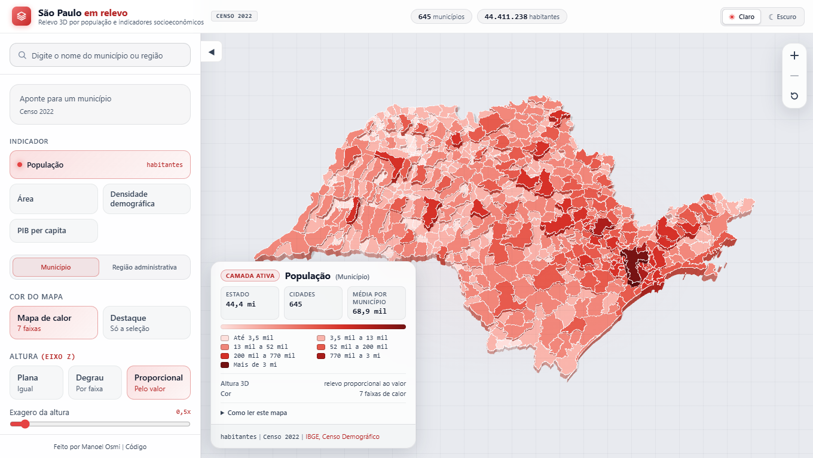

# São Paulo em relevo

Visualização tridimensional dos 645 municípios do Estado de São Paulo com relevo proporcional a indicadores socioeconômicos e demográficos, renderizada com Three.js em navegador sem etapa de build.

## O que é

Uma aplicação interativa para exploração do território paulista em 3D. Cada município é representado como uma coluna com altura proporcional ao indicador selecionado e coloração dinâmica em mapa de calor. Permite selecionar municípios ou regiões administrativas inteiras, consultar totais agregados e inspecionar detalhes socioeconômicos.

## Captura



## Como rodar

O projeto utiliza JavaScript nativo em módulos ES e Three.js r185 via import map, sem necessidade de empacotamento ou transfiguração prévia.

1. Instale as dependências de desenvolvimento:
   ```bash
   npm install
   ```

2. Inicie o servidor local:
   ```bash
   npm start
   ```

3. Abra `http://localhost:4173` no navegador.

Para executar a suíte completa de testes:
```bash
npm run verify
```

## Decisões

As principais decisões de arquitetura e visualização adotadas no projeto:
- Renderização 3D em chamada única de desenho (`BatchedMesh`) para os 645 municípios, com desenho sob demanda (zero quadros ociosos quando parado).
- Separação estrita em quatro camadas (`src/domain/`, `src/engine/`, `src/features/` e `src/app/`), sem dependências externas além do Three.js.
- Escala logarítmica geométrica de 7 faixas para municípios e quantis de 7 faixas para as 16 regiões administrativas, com paleta em espaço perceptivo OKLab.
- Dados pré-processados a partir das bases oficiais em [data/](data/) e recursos visuais em [docs/](docs/).

## Fontes

Os dados utilizados neste projeto provêm de fontes oficiais públicas:

- **IBGE (Instituto Brasileiro de Geografia e Estatística)**
  - Malha Municipal Digital (2022): [https://www.ibge.gov.br/geociencias/organizacao-do-territorio/malhas-territoriais/15774-malhas.html](https://www.ibge.gov.br/geociencias/organizacao-do-territorio/malhas-territoriais/15774-malhas.html)
  - Censo Demográfico (2022) - População residente: [https://www.ibge.gov.br/estatisticas/sociais/populacao/22827-censo-demografico-2022.html](https://www.ibge.gov.br/estatisticas/sociais/populacao/22827-censo-demografico-2022.html)
  - Produto Interno Bruto dos Municípios (2023): [https://www.ibge.gov.br/estatisticas/economicas/contas-nacionais/9088-produto-interno-bruto-dos-municipios.html](https://www.ibge.gov.br/estatisticas/economicas/contas-nacionais/9088-produto-interno-bruto-dos-municipios.html)

- **Fundação Seade (Sistema Estadual de Análise de Dados)**
  - Municípios e Regiões Administrativas do Estado de São Paulo (2026): [https://www.seade.gov.br](https://www.seade.gov.br)

## Atribuição dos dados

Os dados vêm de fontes públicas. Cada uma é citada abaixo, com link e data de acesso.

A condição de licença de cada fonte está no `meta` dos arquivos de `data/`.

### IBGE

- **Malha municipal.** IBGE, Malha Municipal, 2022. [Página do produto](https://www.ibge.gov.br/geociencias/organizacao-do-territorio/malhas-territoriais/15774-malhas.html). Acesso em 16/10/2026. O IBGE libera a malha sob licença compatível com CC BY 4.0, com crédito. Condições de uso: [Notas metodológicas 01/2026](https://biblioteca.ibge.gov.br/visualizacao/livros/liv102268.pdf).
- **Censo Demográfico 2022.** IBGE, SIDRA, tabela 4714, 2022. [Tabela no SIDRA](https://sidra.ibge.gov.br/tabela/4714). Acesso em 16/10/2026.
- **PIB dos Municípios 2023.** IBGE, SIDRA, tabela 5938, 2023. [Tabela no SIDRA](https://sidra.ibge.gov.br/tabela/5938). Acesso em 16/10/2026.

Aviso sobre a malha: este projeto a processou, com projeção e quantização, e ela mudou de característica em relação à original. Os limites são aproximados e não oficiais.

### Fundação Seade

- **Municípios do Estado de SP.** Fundação Seade, Municípios do Estado de SP, 2026. Composição das 16 regiões administrativas e seus rótulos. [Conjunto de dados](https://repositorio.seade.gov.br/dataset/1617c335-f5ab-426c-b175-280d4e41ec1c). Acesso em 16/10/2026.

## Licença

Distribuído sob licença MIT. Copyright (c) 2026 Manoel Osmi.
